# Sales Sentinel — Automated Sales Data Cleaning

### Problem · Approach · Architecture · Results

**GGTP Capstone 5 · POC** · Manas Dutt · Python 3.11 (standard library only) · Claude Code (2 agents, hooks, MCP)

> A daily sales CSV from 50+ stores arrives full of missing values, duplicates, invalid amounts and
> mixed date formats. An analyst spends **2 hours a day** cleaning it by hand.
> **Sales Sentinel does it with one command, in under a second, and accounts for every row.**

| Contents | |
|---|---|
| **Part A — The problem** | [1 Problem statement](#1-problem-statement) · [2 What the data really looked like](#2-what-the-data-really-looked-like) |
| **Part B — The approach** | [3 Approach: ledger-first cleaning](#3-approach-ledger-first-cleaning) · [4 Solution at a glance](#4-solution-at-a-glance) |
| **Part C — Architecture** | [5 System overview](#5-system-overview) · [6 Pipeline](#6-pipeline-runtime) · [7 Modules](#7-module-design) · [8 Data model](#8-data-model) · [9 Agent workflow](#9-agent-workflow) · [10 Guardrails](#10-guardrails-hooks) · [11 MCP server](#11-mcp-server) |
| **Part D — Results** | [12 Results on the sample](#12-results-on-the-sample) · [13 Requirements checklist](#13-requirements-checklist) · [14 Quality & verification](#14-quality--verification) · [15 Key decisions](#15-key-design-decisions) |
| **Part E — Wrap-up** | [16 Demo script](#16-demo-script) · [17 Limitations & risks](#17-limitations--risks) · [18 How AI was used](#18-how-ai-was-used--lessons-learned) · [19 Business questions](#19-open-business-questions) · [20 Extending](#20-extending-the-system) · [21 How to run](#21-how-to-run) |

---

# Part A — The problem

## 1. Problem statement

**Scenario.** A retail chain processes daily sales transactions from 50+ stores. The data arrives as
CSV (`transaction_id, date, amount, store_id, category`) and is consistently messy. Today an analyst
cleans it by hand every day, which takes **2 hours**.

**Task.** Build a script that does this automatically:

| Step | Required |
|---|---|
| 1. Ingest | Read `sample_sales_data.csv`; handle file-reading errors gracefully |
| 2. Clean | Handle missing values, duplicates, invalid amounts, inconsistent date formats; document decisions in `DECISIONS.md` |
| 3. Validate & report | Write `clean_sales.csv` and `data_quality_report.txt` with rows processed, rows removed (duplicates), nulls filled, invalid entries fixed/skipped, and an overall quality score (own metric) |

**Must-haves.** Runs with `python src/main.py` and no manual steps · processes the whole file ·
handles every issue · 3–5 tests covering normal and edge cases · no hardcoded paths · no secrets ·
`DECISIONS.md` · `REFLECTION.md` (how AI was used, mistakes caught).

**Out of scope.** Database, visualisation / Power BI, ML anomaly detection, APIs, web UI.

**Extra brief for this build.** Use two Claude Code agents, a **coder** (may only edit `src/`)
and a **tester** (may only edit `tests/`), defined in `CLAUDE.md`. Use **hooks** and **MCP**.
Work from `SPEC.md`, `PLAN.md`, `TO-DO.md` and `SKILL.md`. The approach should stand out from a
run-of-the-mill script.

## 2. What the data really looked like

Before writing any code we profiled the file (also available to the agents as the MCP tool `profile_csv`):

| Issue | Rows | Examples | Hidden trap |
|---|---|---|---|
| Missing amount | **32** | `5,2026-10-21,,S002,Clothing` | Filling with 0 would invent zero-value sales |
| Non-numeric amount | 2 | `abc`, `xyz` | Garbage ≠ missing: the row is corrupted |
| Negative amount | 1 | `-50.00` | It's a refund. `abs()` would turn it into a sale |
| Zero amount | 2 | `0.00`, `0` | Voids / test scans, not sales |
| Non-ISO date | 5 | `10/21/26`, `2026/10/21`, `10-21-2026`, `20261021` | `10/21/26` proves month-first (MM/DD) |
| Unparseable date | 1 | `invalid` | — |
| Off-day date | 1 | `2026-10-20` in a 10-21 batch | A late posting, not an error |
| Extreme amount | 1 | `3500.00` Electronics | Could be a real TV sale, so it must not be deleted |
| **"Duplicates"** | **70** | `150.50, S001, Electronics` appears **53×** | **All 200 transaction IDs are unique.** Dedupe by ID finds **0** duplicates |

> **Key insight.** The obvious duplicate check (same `transaction_id`) finds nothing. The real
> duplicates are **content replays**: the same date, amount, store and category under new IDs,
> the signature of a POS double-submit. A naive script either misses all 70, or deletes them
> silently with no way to explain or undo it.

---

# Part B — The approach

## 3. Approach: ledger-first cleaning

A typical cleaning script is a chain of `dropna()` and `drop_duplicates()` calls: rows vanish and no
one can say why. **Sales Sentinel treats cleaning as an accounting problem.**

| # | Principle | What it means in practice |
|---|---|---|
| 1 | **Every row gets a fate** | `KEPT_CLEAN`, `KEPT_REPAIRED`, `KEPT_IMPUTED`, `REMOVED_DUPLICATE` or `QUARANTINED`, with reason codes, in `row_ledger.csv` |
| 2 | **Rows and money must balance** | `processed = kept + duplicates + quarantined`, and raw total = clean total − imputed + duplicates + quarantined. Otherwise the run fails |
| 3 | **Quarantine, don't delete** | Rejected rows keep their *original* values and *all* their problems, ready to send back to the store |
| 4 | **Repair only the unambiguous** | Date format, `$1,200`, `s001` → fixed. Refunds, garbage, unknown categories → never guessed |
| 5 | **Money is `Decimal`** | No float rounding errors; half-up to 2 decimals |
| 6 | **Policies are config, not code** | Dedupe policy, imputation strategy, date order, categories and score weights live in `config/pipeline.toml` |
| 7 | **Self-checking output** | The clean file is re-validated after writing, and running the cleaner on its own output changes nothing |
| 8 | **Spec-driven, two-agent build** | `SPEC.md` has 47 numbered rules. The tester writes tests from the spec and the coder writes code to pass them. Hooks stop either from touching the other's files |

**Typical script vs Sales Sentinel**

| | Typical script | Sales Sentinel |
|---|---|---|
| Bad rows | deleted | quarantined with reasons |
| Duplicates | by ID → finds 0 | content replays → finds 70, reports bursts and revenue impact, policy switch |
| Missing amounts | mean or 0 | median by store+category, *after* dedupe, flagged |
| Outliers | deleted (or ignored) | flagged, kept, reviewed |
| Money | `float` | `Decimal` |
| Quality score | "% rows kept" | 4 standard dimensions + output confidence + money check |
| Audit trail | none | ledger + manifest with sha256 hashes |
| Automation | exit 0 always | exit codes 0/1/2/3 + `--strict` quality gate |
| Build process | one AI writes code and tests | two agents, hook-enforced boundary, mutation-tested |

## 4. Solution at a glance

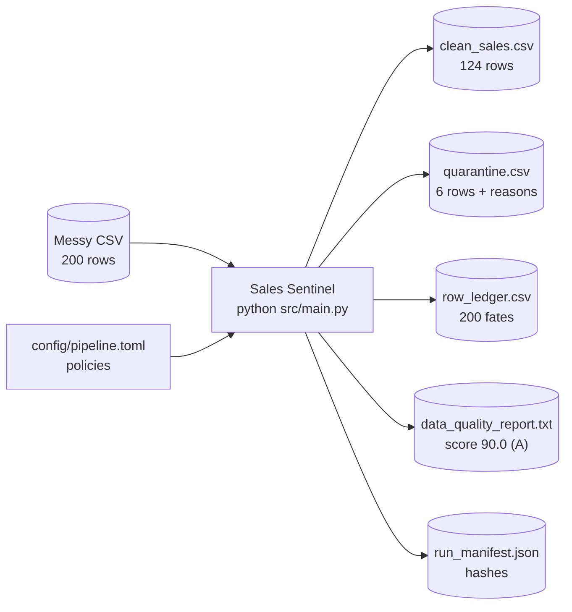

**Two halves, designed together:**

1. **The product.** A zero-dependency Python pipeline that turns the messy CSV into clean, audited data.
2. **The factory.** A Claude Code setup where a **coder** agent and a **tester** agent build and check
   the product under hook-enforced rules, with an MCP server for data tools and `SPEC.md` as the contract.

---

# Part C — Architecture

## 5. System overview

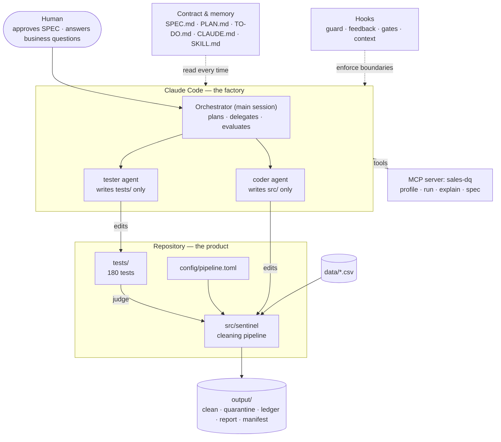

| Layer | Responsibility | Lives in |
|---|---|---|
| Contract | What must be true (rule IDs, golden numbers) | `SPEC.md` |
| Orchestration | Who does what, when; hand-offs | `CLAUDE.md`, `PLAN.md`, `TO-DO.md`, `.claude/commands/cycle.md` |
| Agents | Implement (coder) and verify (tester) | `.claude/agents/*.md` (mirrors of `CLAUDE.md` §4) |
| Enforcement | Make the rules impossible to break quietly | `.claude/hooks/*`, `.claude/settings.json` |
| Tooling | Let agents inspect data and the spec | `tools/mcp_server/dq_server.py`, `.mcp.json` |
| Product | Clean the data | `src/sentinel/*`, `config/pipeline.toml` |
| Judge | Decide if the product is correct | `tests/*`, `tools/spec_coverage.py`, `tools/mutation_smoke.py` |

---

## 6. Pipeline (runtime)

`python src/main.py` → `cli.main()` runs one deterministic batch:

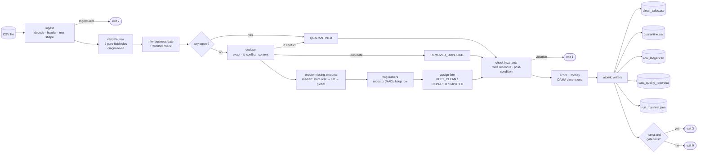

**Why this stage order:**

| Order | Reason |
|---|---|
| Validate everything before deciding anything | A row's full list of problems goes to the quarantine file, not just the first one |
| Business date after parsing | It is the modal *valid* date, so it needs parsed dates |
| Dedupe **before** imputation | (a) A guessed amount is never evidence of duplication. (b) 53 replayed `150.50` rows would otherwise drag the median to 150.50 |
| Medians frozen before any fill | The result doesn't depend on row order, and imputed values never feed other imputations |
| Outliers after fates | Scored only on kept, observed values; flag-only, so it can't change counts |
| Invariants before writing | A broken ledger never reaches disk |

**Sample run (200 rows):** 124 kept (87 clean · 5 repaired · 32 imputed) + 70 duplicates + 6 quarantined = 200 ✔

---

## 7. Module design

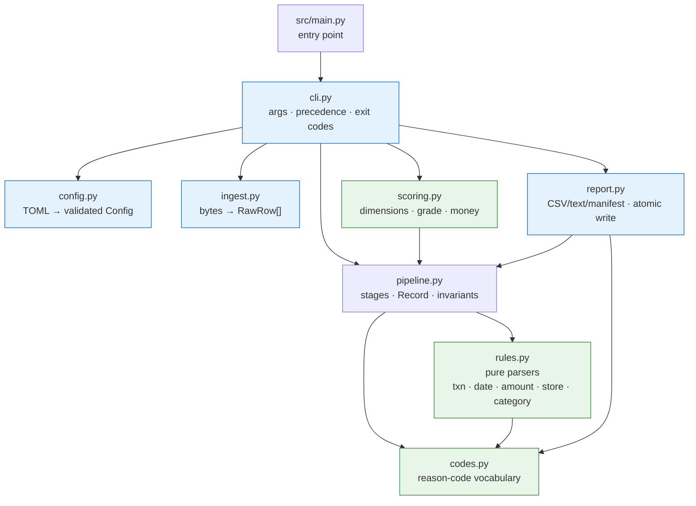

| Module | Kind | Owns rules | Key API |
|---|---|---|---|
| `config.py` | I/O + validation | R-ING-01, R-OPS-02 | `load_config(path) -> Config`, `resolve_path(cli, env, cfg)` |
| `ingest.py` | I/O | R-ING-02…06 | `read_csv(path) -> IngestResult` |
| `codes.py` | constants | — | error / duplicate / repair / warning sets + descriptions |
| `rules.py` | **pure** | R-TXN, R-DATE-01…03, R-AMT-01…07, R-STORE, R-CAT | `parse_*()` / `normalize_*()` → `FieldResult` |
| `pipeline.py` | orchestration | R-DATE-04, R-DUP, R-IMP, R-AMT-08, R-INV | `run_pipeline(rows, cfg) -> PipelineResult` |
| `scoring.py` | **pure** | R-SCORE | `score(result)`, `money(result)` |
| `report.py` | I/O | R-OUT | `write_outputs(dir, …)`, `atomic_write()` |
| `cli.py` | shell | R-OPS-01/04 | `main(argv) -> exit code` |

Dependency rule: `rules.py` and `codes.py` import nothing from the project, so they can be
table-tested in isolation. I/O stays at the edges (`ingest`, `report`, `cli`).

---

## 8. Data model

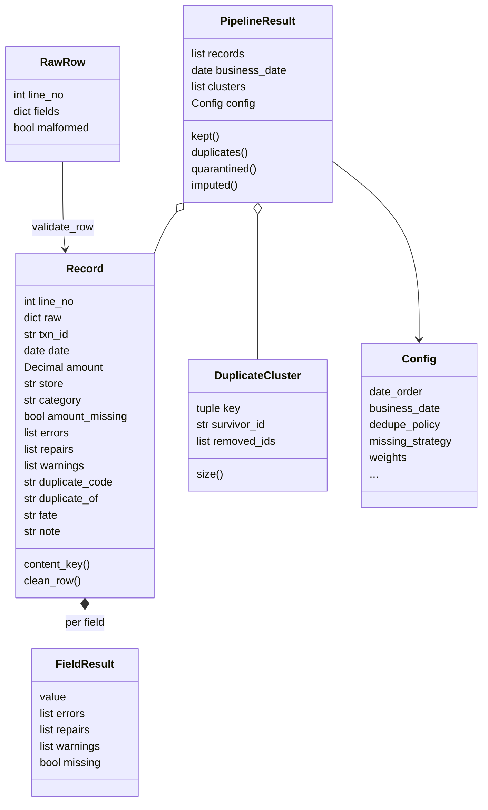

**Row fate state machine.** Every row ends in exactly one terminal state:

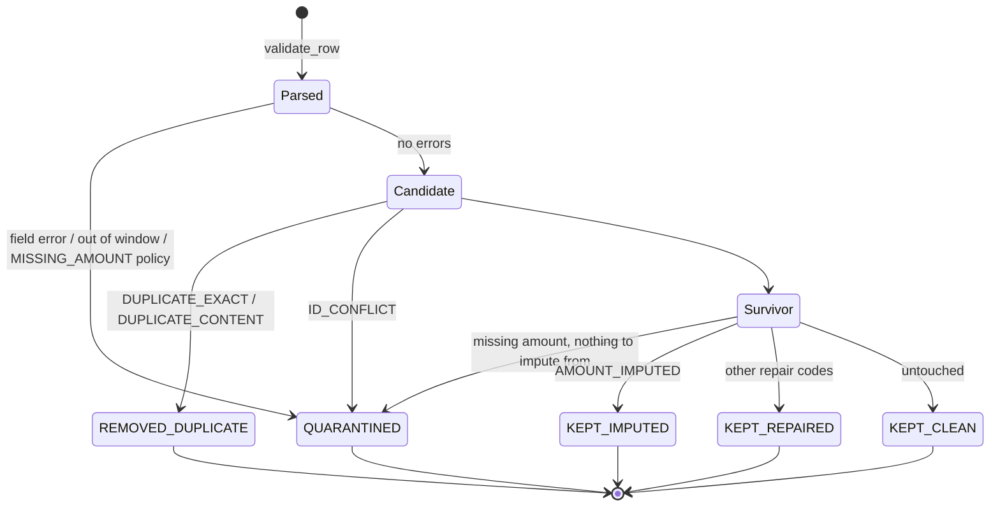

**Outputs as contracts:**

| File | Grain | Consumer | Guarantee |
|---|---|---|---|
| `clean_sales.csv` | one row per kept sale | downstream analytics | re-validates with 0 errors/repairs; unique `transaction_id` |
| `quarantine.csv` | one row per rejected input | stores / data owners | original raw values + all reason codes |
| `row_ledger.csv` | one row per **input** row | auditors, `explain_row` | count = rows processed |
| `data_quality_report.txt` | one per run | analyst | required summary lines verbatim (R-OUT-04) |
| `run_manifest.json` | one per run | ops / reproducibility | sha256 of input, config, every output |

---

## 9. Agent workflow

The deck's 5-step loop, as it runs in Claude Code (`/cycle <rule IDs>`):

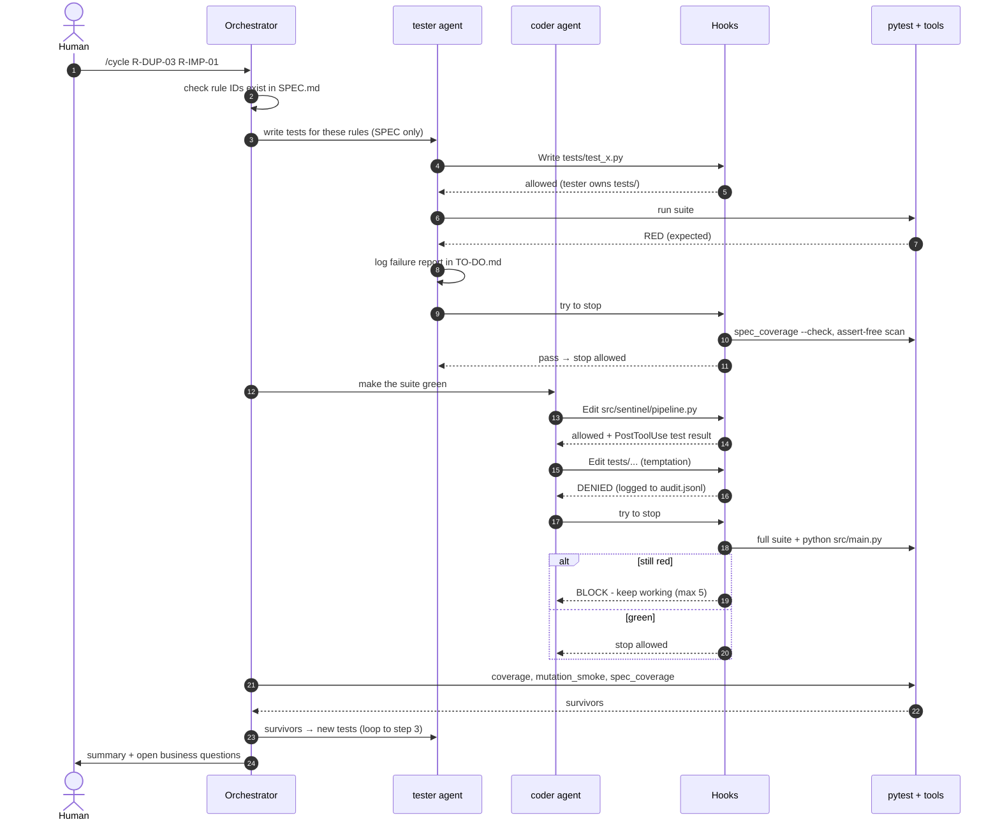

**Why two agents:** the agent that writes the code tends to write tests that pass it. The tester
works from the spec alone, in its own context, and is physically blocked from "fixing" `src/`.

---

## 10. Guardrails (hooks)

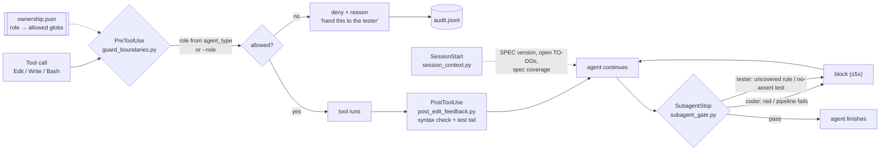

**Ownership matrix** (from `.claude/hooks/ownership.json`):

| Path | Orchestrator | coder | tester |
|---|---|---|---|
| `src/**` | ✗ delegate | **RW** | R |
| `tests/**` | ✗ delegate | R | **RW** |
| `config/**` | RW | RW | R |
| `SPEC.md` | RW (human-approved) | R | R |
| `TO-DO.md` | RW | RW | RW |
| `DECISIONS.md` | RW | RW | R |
| `.claude/**`, `tools/**`, `.mcp.json` | RW | ✗ | ✗ |
| `data/**`, `output/**`, `.env*` | ✗ | ✗ | ✗ |

**Defence in depth:**
1. **Soft:** `CLAUDE.md` and the agent prompts state the rules. In live testing the coder refused on its own.
2. **Hard:** a PreToolUse hook, wired in two places: `settings.json` (role from `agent_type`) and agent
   frontmatter (`--role`).
3. **Bash-aware:** catches `>`, `tee`, `sed -i`, `mv`, `cp`, `rm`, `git checkout/restore` and
   `python -c open(..,'w')` aimed at forbidden paths.
4. **Fail closed:** `run.sh` exits 2 if no Python is found, and the guard denies agent writes if it crashes.
5. **Self-protecting:** agents can't edit `.claude/**`, so they can't switch off their own guard.
6. **Auditable:** every deny, block and pass is appended to `.claude/state/audit.jsonl`.

---

## 11. MCP server

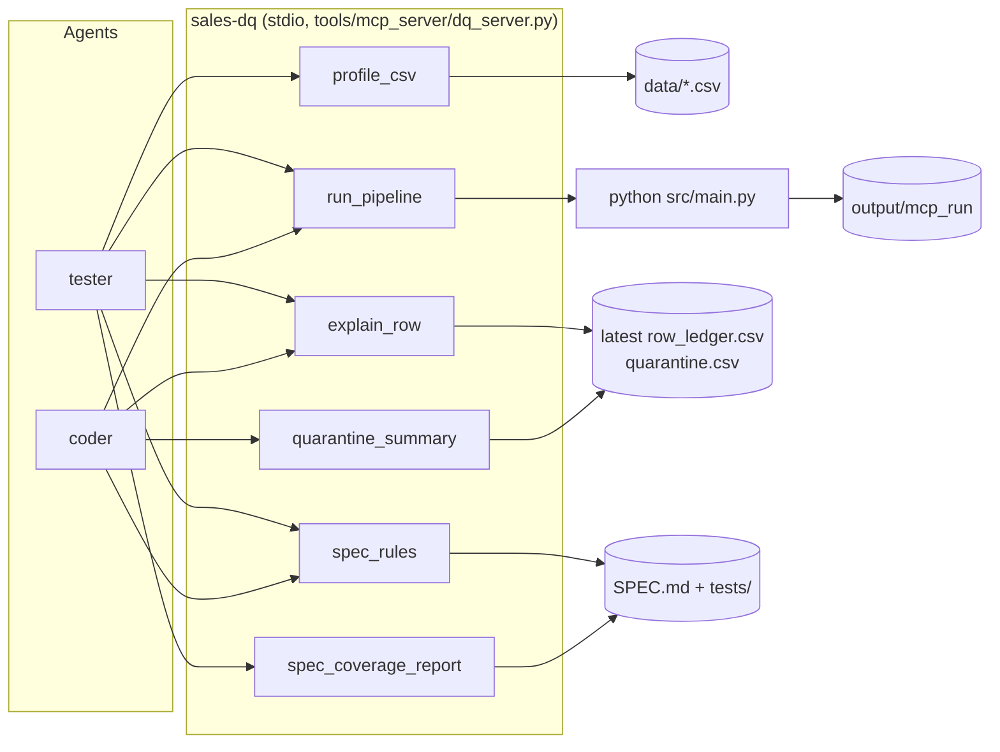

- **Discovery:** `profile_csv` groups values by "shape" (`9999-99-99` vs `99/99/99`) and lists duplicate
  clusters, so the tester finds edge cases in the real data.
- **Explainability:** `explain_row("8")` returns `REMOVED_DUPLICATE · DUPLICATE_CONTENT · duplicate_of 1`.
- **Traceability:** `spec_coverage_report` shows which rule IDs have no test yet.
- **Safety:** every path is confined to the project root. It writes only under `output/`. Works with `mcp` 1.x and 2.x.

---

# Part D — Results

## 12. Results on the sample

```
$ python src/main.py
OK processed=200 kept=124 duplicates=70 quarantined=6 nulls_filled=32 score=90.0(A)
```

**Required report summary** (verbatim from `data_quality_report.txt`):

```
Rows processed: 200
Rows removed: 70 (duplicates)
Nulls filled: 32
Invalid entries fixed/skipped: 11 (fixed 5, skipped 6)
Overall data quality score: 90.0/100 (A)
```

**Where every row went:**

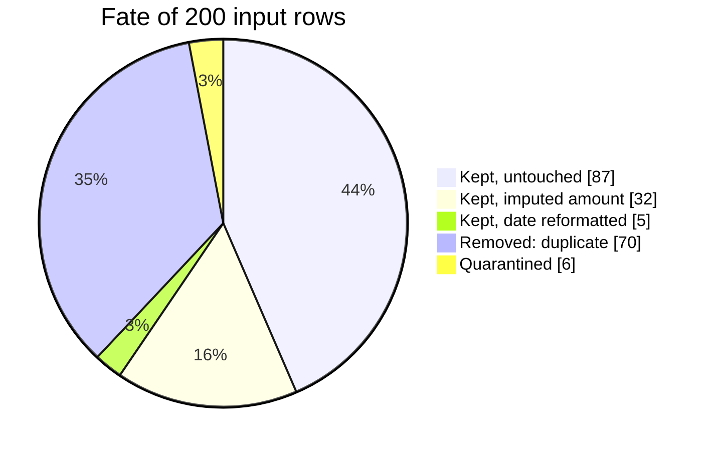

| Metric | Value | Meaning |
|---|---|---|
| Completeness | 96.8 % | share of required cells that were filled in |
| Validity | 99.4 % | share of filled cells that pass their rule |
| Consistency | 99.5 % | share of valid cells already in standard format |
| Uniqueness | 65.0 % | share of rows that are not duplicates (the weakest dimension) |
| **Overall score** | **90.0 / 100 (A)** | weighted 30 / 30 / 15 / 25 |
| Yield | 62.0 % | rows kept / rows processed |
| Quarantine rate | 3.0 % | under the 10 % alert threshold |

**Money reconciliation** (balances exactly, in `Decimal`):

| | Amount |
|---|---:|
| Raw total of all readable amounts | 47,619.74 |
| − Duplicates removed | 10,559.50 |
| − Quarantined | 75.00 |
| + Imputed (estimated) | 10,175.76 |
| **= Clean total** | **47,161.00** |
| of which observed (not imputed) | 36,985.24 |

**Duplicate bursts found:**

| Key (date · amount · store · category) | Copies | Revenue removed |
|---|---:|---:|
| 2026-10-21 · 150.50 · S001 · Electronics | 53 | 7,826.00 |
| 2026-10-21 · 150.50 · S001 · Clothing | 12 | 1,655.50 |
| 2026-10-21 · 150.50 · S001 · Grocery | 6 | 752.50 |
| 2026-10-21 · 280.50 · S001 · Electronics | 2 | 280.50 |
| 2026-10-21 · 45.00 · S001 · Clothing | 2 | 45.00 |

**Business impact:** 2 hours of manual work per day becomes one command that finishes in under a
second, with an audit trail the analyst never had.

## 13. Requirements checklist

| Requirement (problem statement) | Status | Where |
|---|:---:|---|
| Runs without manual intervention: `python src/main.py` | ✅ | `src/main.py`, `config/pipeline.toml` |
| Processes the sample CSV completely | ✅ | 200/200 rows reconciled (R-INV-01) |
| Handles file-reading errors gracefully | ✅ | exit 2 + one-line message, no traceback (R-ING-02…05) |
| Missing values | ✅ | median imputation, flagged (R-IMP) |
| Duplicates | ✅ | exact + content + ID conflict (R-DUP) |
| Invalid amounts | ✅ | non-numeric / negative / zero / ceiling → quarantine (R-AMT) |
| Inconsistent date formats | ✅ | 9 formats → ISO, ambiguity warning (R-DATE) |
| `clean_sales.csv` in the given format | ✅ | header and format verified by test (R-OUT-01) |
| `data_quality_report.txt` with the 5 required lines | ✅ | verbatim lines (R-OUT-04) |
| Own quality score metric | ✅ | DAMA 4-dimension score + grade (R-SCORE) |
| 3–5 tests covering normal and edge cases | ✅ | 5 test modules (180 test cases) |
| No hardcoded file paths | ✅ | CLI > env > config; checked by a test |
| No secrets committed | ✅ | `.gitignore`; hooks block `.env` access |
| `DECISIONS.md` | ✅ | 17 decisions + open business questions |
| `REFLECTION.md` | ✅ | 11 real mistakes caught and fixed |
| Not built: DB, viz, ML, API, UI | ✅ | checked by a test (no such imports) |
| **Brief:** coder + tester agents in `CLAUDE.md` | ✅ | `CLAUDE.md` §4 + `.claude/agents/` |
| **Brief:** hooks | ✅ | 4 hook events, verified live |
| **Brief:** MCP | ✅ | `sales-dq` server, 6 tools, verified live |
| **Brief:** spec / plan / to-do / claude / skill files | ✅ | `SPEC.md`, `PLAN.md`, `TO-DO.md`, `CLAUDE.md`, `.claude/skills/.../SKILL.md` |

## 14. Quality & verification

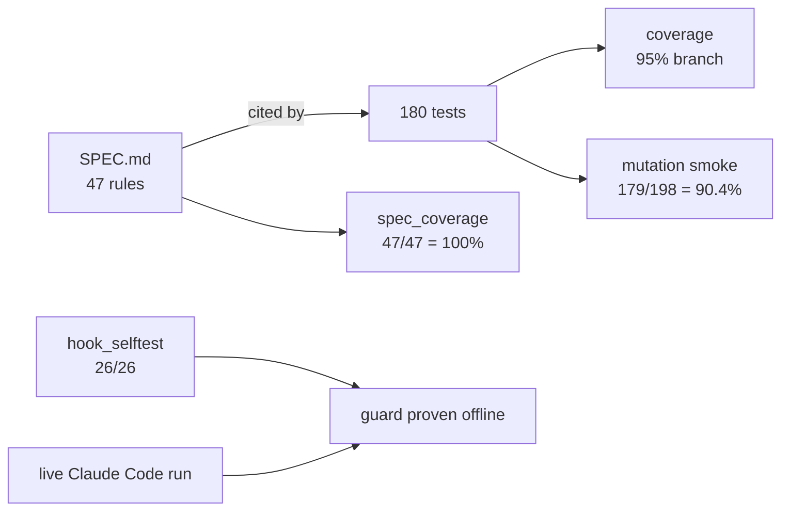

| Test module | Focus | Technique |
|---|---|---|
| `test_ingest.py` | files, headers, encodings, config, exit codes | real files + subprocess `python src/main.py` |
| `test_field_rules.py` | every field rule | Given/When/Then `parametrize` tables |
| `test_pipeline.py` | dedupe, imputation, window, outliers, invariants | small hand-built batches |
| `test_e2e_sample.py` | golden numbers from SPEC §4, outputs, determinism, idempotence | full run on the sample |
| `test_properties.py` | invariants hold for *any* messy input | Hypothesis fuzzing |

Runtime invariants (they fail the run, not just a test): row reconciliation, money reconciliation,
and the post-condition re-validation of `clean_sales.csv`.

---

## 15. Key design decisions

| Decision | Choice | Instead of | Ref |
|---|---|---|---|
| Bad rows | Quarantine with reasons | delete | D-01 |
| Money | `Decimal`, half-up | `float` | D-02 |
| Dates | explicit formats + ambiguity warning | `dateutil` guessing | D-03 |
| Duplicates | content key (ids are all unique), burst report, policy switch | id-only (finds 0) | D-04 |
| Missing amounts | hierarchical median, after dedupe | mean / 0 / drop | D-05, D-07 |
| Outliers | flag (robust z), never remove | remove / ML | D-10 |
| Dependencies | stdlib only | pandas | D-17 |
| Agent boundary | hooks + ownership.json | prompt instructions only | §6 |

Full reasoning is in `DECISIONS.md`.

---

# Part E — Wrap-up

## 16. Demo script

About 10 minutes, following the flow in the *AI Coding & Testing* deck.

| # | Show | Command / action | Point to make |
|---|---|---|---|
| 1 | The contract | open `SPEC.md` §4 | Golden numbers were derived by hand *before* any code |
| 2 | The messy data | `profile_csv` via Claude, or open the CSV | All 200 IDs are unique, yet 53 rows repeat the same sale |
| 3 | One-command clean | `python src/main.py` | Summary line; open the report and walk through the required lines |
| 4 | Explainability | `row_ledger.csv` → row 8; or ask Claude to `explain_row 8` | "Why was this row removed?" has an answer: duplicate of id 1 |
| 5 | Quarantine | open `quarantine.csv` | Raw values + reasons, ready to send back to the store |
| 6 | The judge | `python -m pytest` | 180 passed |
| 7 | Tests of the tests | show the mutation result (90.4 %) | Green tests aren't enough; the survivors told us which tests were weak |
| 8 | The guardrail | in Claude Code: ask the coder agent to edit a test | Hook denies it and logs it to `.claude/state/audit.jsonl` |
| 9 | Offline proof | `python tools/hook_selftest.py` | 26/26 boundary cases |
| 10 | Policy switch | `python src/main.py --dedupe-policy id` | Duplicates 70 → 0. The business decides, not the code |

## 17. Limitations & risks

| Limitation / risk | Impact | Mitigation |
|---|---|---|
| Content dedupe may remove genuine identical sales | Up to 10,559.50 revenue on the sample | Burst report + `--dedupe-policy id`; open business question |
| Imputation creates estimated revenue (25.8 % of kept rows) | Reported revenue includes estimates | Imputed total reported separately; `--missing-strategy quarantine` available |
| Median imputation often matches a real row (26 of 32) | A later content-dedupe could remove them | Both rows flagged `IMPUTED_KEY_COLLISION`; contract: dedupe the clean file by ID only |
| MM/DD vs DD/MM ambiguity | A wrong date for days ≤ 12 | Configured order + `AMBIGUOUS_DATE` warning |
| Single-file, single-batch design | Doesn't yet merge 50 store files | Multi-file mode is in the backlog |
| Agent independence at bootstrap | Code and tests were first written in one session | Hand-derived golden numbers, property tests, mutation testing; first follow-up task is a fresh tester run |
| Bash guard is heuristic | An unusual command could slip past | Defence in depth: prompts + hook + `.claude/` locked + audit log + fail-closed |

## 18. How AI was used — lessons learned

| Mistake caught | How it was caught | Fix |
|---|---|---|
| "Duplicate = same ID" finds 0 | Profiling before coding | Content dedupe + burst report + policy switch |
| Collision guard flagged only one side | Idempotence test (R-INV-03) failed | Flag both rows; SPEC bumped to v1.1.0 |
| Score values were never tested | Mutation testing (74 % at first) | Exact hand-computed score tests → 90.4 % |
| Coverage showed 58 % | Coverage didn't follow subprocess runs | Subprocess coverage enabled → 95 % |
| Guard bypass via `python -c open(...)` | Hook self-test | Quoted paths now inspected |
| Guard could fail open if Python is missing | Review | `run.sh` launcher exits 2 (blocking) |
| Agent refused politely, so the hook was never tested | Live Claude Code run | Acceptance test now has the agent *attempt* the edit |

**Takeaways (from the deck, confirmed here):** write tests from the spec, not the code · hunt edge
cases on purpose · measure test quality, not only pass rate · two agents beat one · enforce rules
with hooks, not just prompts. Full details are in `REFLECTION.md`.

## 19. Open business questions

1. Are the 53 identical `150.50 / S001 / Electronics` sales a POS replay? If they're genuine, switch to
   `--dedupe-policy id` (+10,559.50 revenue).
2. Should refunds (negative amounts) go to a separate refunds feed instead of quarantine?
3. Is estimated (imputed) revenue acceptable in reporting, or should missing-amount rows go back to the stores?

## 20. Extending the system

| You want to… | Touch | Flow |
|---|---|---|
| Add a cleaning rule | `SPEC.md` (new `R-` ID) → tester → coder | `/cycle R-NEW-01` |
| Add a reason code | `codes.py` + SPEC | coder, after SPEC approval |
| Change a policy (e.g. dedupe by id) | `config/pipeline.toml` or `--dedupe-policy id` | no code change |
| Add a category / alias | `[domain]` in config | no code change |
| Process many files | new CLI mode in `cli.py` (backlog in TO-DO.md) | spec first |
| Let a new agent join | add a role to `ownership.json` + `.claude/agents/<name>.md` | orchestrator only |
| Schedule daily | cron / Task Scheduler running `python src/main.py --strict`; alert on exit ≠ 0 | ops |


## 21. How to run

```powershell
python -m venv .venv
.venv\Scripts\activate                 # macOS/Linux: source .venv/bin/activate
python -m pip install -r requirements-dev.txt

python src/main.py                     # clean the sample -> output/
python src/main.py --input X.csv --output-dir out --strict
python -m pytest                       # 180 passed
python tools/spec_coverage.py          # 47/47 rules covered
python tools/hook_selftest.py          # 26/26 guard cases
claude                                 # then: /cycle R-DUP-03 R-IMP-01
```

**Repository map**

```
day3/
├── SPEC.md  PLAN.md  TO-DO.md  CLAUDE.md  ARCHITECTURE.md  DECISIONS.md  REFLECTION.md  README.md
├── config/pipeline.toml          policies
├── data/sample_sales_data.csv    input (read-only)
├── src/main.py, src/sentinel/    the pipeline (coder-owned)
├── tests/                        5 test modules (tester-owned)
├── tools/                        spec_coverage · mutation_smoke · hook_selftest · mcp_server/
├── .claude/agents/               coder.md · tester.md
├── .claude/hooks/                guard · feedback · gate · session context · ownership.json
├── .claude/skills/…/SKILL.md     domain playbook
├── .claude/commands/cycle.md     /cycle
└── .mcp.json                     sales-dq MCP server
```
